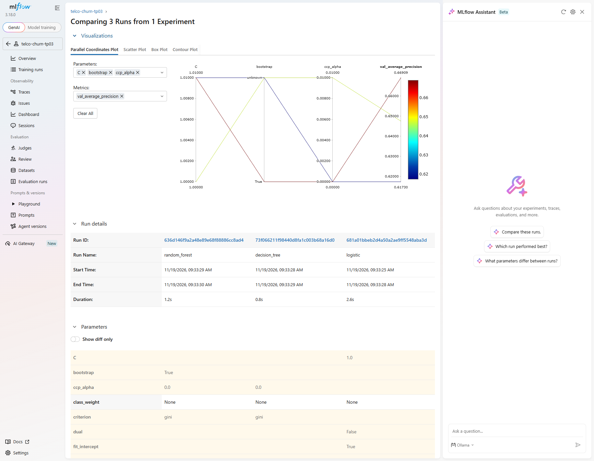
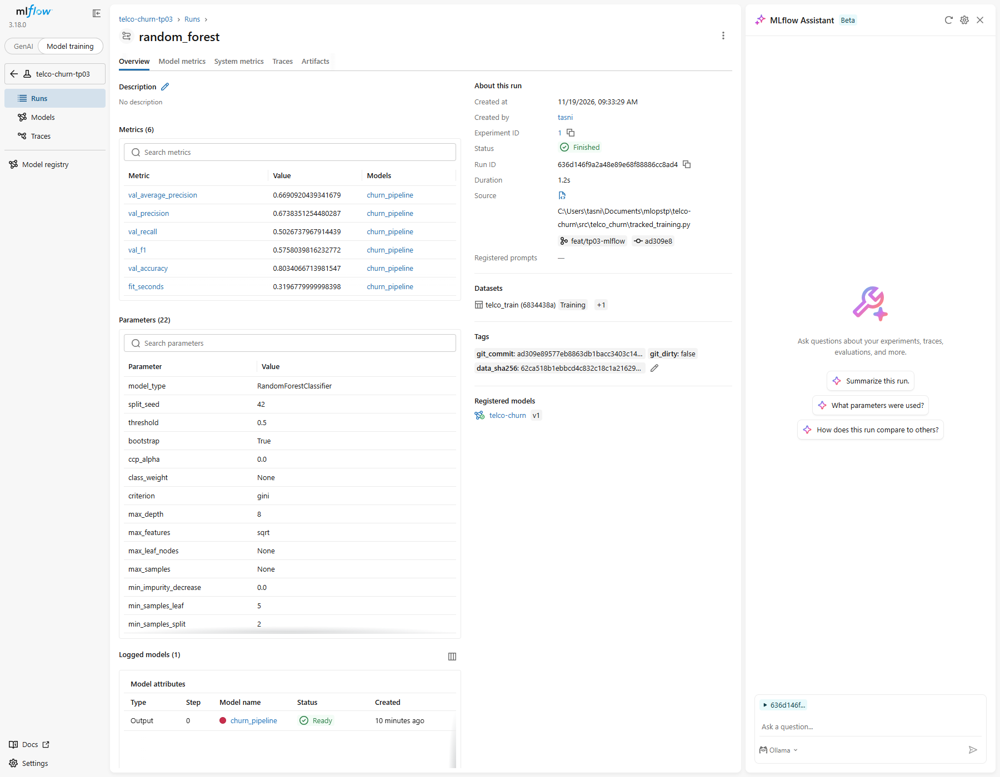
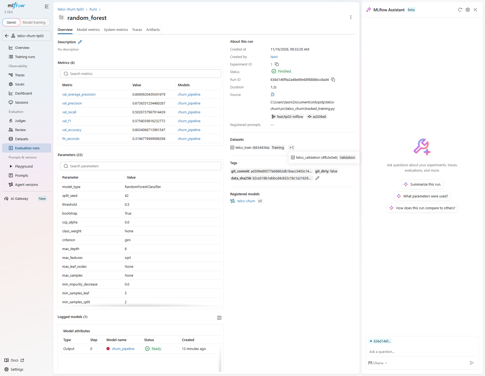
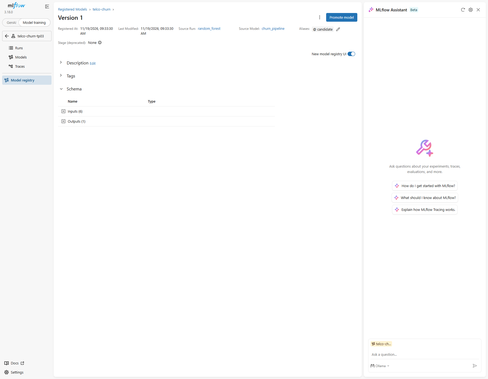

# TP03 ? MLflow experiment tracking and recovery

## Comparison and selection

| Run ID | Candidate / settings | Validation AP | Recall | F1 | Decision |
|---|---|---:|---:|---:|---|
| `681a01bbeb2d4a50a2ae9ff5548aba3d` | logistic: C=1, max_iter=1000 | 0.647466 | 0.529412 | 0.589286 | Not selected |
| `73f066211f98440d8fa1c003b68a16d0` | decision_tree: depth=5, min_leaf=20 | 0.617300 | 0.601604 | 0.618132 | Not selected |
| `636d146f9a2a48e89e68f88886cc8ad4` | random_forest: trees=100, depth=8, min_leaf=5 | 0.669092 | 0.502674 | 0.575804 | Selected |

All candidates use TP02's unchanged six features, stratified customer allocations, seed 42, training-only preprocessing and threshold 0.5. Random forest is selected because its validation average precision (0.669092) is the highest under the predefined rule. The tree has higher recall and F1 at this threshold, so the selected model is not best on every metric. The forest takes longer to fit, but this small local comparison does not establish statistical significance or deployment performance. No test predictions or test metrics were computed.



## Selected run and dataset contexts




The API-exported selected run record, including both dataset schemas/digests and contexts, is in `evidence/tp03/selected_run_record.json`. Dataset digests describe the logged tables; they are not the original-file SHA-256 and do not preserve the DataFrames.

## Model handover identifiers

- Source run ID: `636d146f9a2a48e89e68f88886cc8ad4`.
- Logged model URI: `models:/m-8b8a33699ffc449a865769a2754d0492`.
- Registry name: `telco-churn`; version: `1`; alias: `candidate`.
- Alias URI: `models:/telco-churn@candidate`.
- Training code Git commit: `ad309e89577eb8863db1bacc3403c140190b3c52`; tracked working tree dirty: `False`.
- Original CSV SHA-256: `62ca518b1ebbcd4c832c18c1a21629b03abe9033fef66fe2e38d8d030658a20c`.



The logged pipeline includes the fitted numeric/categorical preprocessing and classifier. Its signature describes three parsed floating-point numeric columns and three categorical string columns, without target or ID. Stateless `prepare_features` parsing remains an explicit inference boundary.

## Fresh-process inference

Keep the local tracking server running and execute from the project root:

```powershell
uv run python -m telco_churn.tracked_prediction
```

This process loads the registered pipeline through its alias, applies the same stateless parsing, and does not call fit or execute training. Five validation feature-only records are used for the agreement check, without labels. The classes matched exactly and probability scores matched with `rtol=0`, `atol=1e-12`. See `evidence/tp03/reload_check.json`. A fresh process demonstrates recovery of fitted state from stored files rather than reuse of an in-memory training object. Moving the alias does not change an already loaded Python object; another load is required, and this entry point refuses an alias/version mismatch against its handover record.

## Restart and storage

The original tracking server was stopped and restarted from the same project root with the same SQLite and artifact options. All three completed candidate runs, registered version 1 and alias candidate remained available. A new inference process again produced identical results; see `after_restart.json` and `restart_check.json`. No database or artifact directory was deleted or renamed. The server was left running in the background; its logs are in the ignored `reports/tp03_server_*.log` files.

SQLite `mlflow.db` preserves experiment/run metadata, parameters, metrics, tags, dataset descriptors and Registry references. `mlartifacts/` preserves model files and logged artifacts. If the database survives but model files are lost, the run history remains but the pipeline cannot be loaded. If only model files survive, trusted models may be recoverable directly with a compatible environment, but run/experiment organization, Registry versions and aliases are missing.

An Experiment groups executions; a Run is one execution; a Parameter is a configuration value; a Metric is a numeric result; an Artifact is a stored file; an MLflow Model packages a fitted object with flavors, schema and environment information. The browser displays records and does not train the model. A fixed seed does not freeze hardware or all library behavior. Different validation allocations confound comparisons; repeatedly selecting on test leaks test information into model selection.

## Reproduction and limits

Start the server using the README command, then run `uv run python -m telco_churn.tracked_training` with the original CSV available. This creates new IDs and a new registered version rather than restoring the historical local IDs. On another machine, the colleague needs the code, compatible locked environment and original input for retraining; to recover the exact recorded runs and aliases they need access to this server or the database plus artifact store, with valid artifact locations. A source hash cannot recover data. A local URI is not an externally accessible submission endpoint.

The database, artifact store and environments remain excluded from Git. Screenshots and small JSON evidence are tracked; do not assume the instructor can open localhost. The implementation and verification were AI-assisted. No human peer review or cross-machine reproduction is claimed. An initial exploratory logistic run encountered a Windows console encoding error; it is not one of the three final comparison runs. The fix was committed before all final runs.
